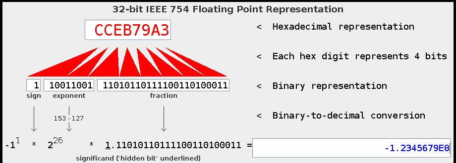

# Lab 7: Floating point (MARS 4.5)

Every answer below was worked out by hand, then checked in the real **MARS 4.5** app in two ways:
- the *Floating Point Representation* tool (GUI screenshots below)
- running the programs with MARS from the command line (output files below)

## Task 1: −123456789 → IEEE 754 single precision

1. **Sign:** the number is negative, so **S = 1**.
2. **Integer to binary.** 123456789 = 0x075BCD15, which is
   `111 0101 1011 1100 1101 0001 0101` (27 bits).
3. **Normalise.** Move the binary point 26 places left:
   `1.11010110111100110100010101 × 2^26`
4. **Exponent:** 26 + 127 = 153 = **`10011001`**.
5. **Fraction:** there are 26 bits after the hidden 1, but only 23 fit.
   - Kept: `11010110111100110100010`
   - Dropped: `101`. The first dropped bit is 1 and the rest are not all 0, so the dropped part is more than half an ULP and we **round up**.
   - Fraction = **`11010110111100110100011`**
6. **Result:**

   | S | Exponent | Fraction | Hex |
   |---|----------|----------|-----|
   | `1` | `10011001` | `11010110111100110100011` | **`0xCCEB79A3`** |

7. **Precision note:** the stored value is −1.11010110111100110100011₂ × 2^26 = **−123456792**.
   A float only has 24 significant bits, so at this size the spacing between floats (the ULP) is 2^(26−23) = 8. The rounding error is 3.

Checked in MARS: [`mars_fp_tool_task1.png`](mars_fp_tool_task1.png) (Floating Point Representation tool), plus
`.float -123456789` loaded into `$f0` (see [`verify_tasks12.asm`](verify_tasks12.asm) and [`mars_tasks12.txt`](mars_tasks12.txt)). MARS shows `$f0 = 0xcceb79a3`, printed as `-1.2345679E8`.

## Task 2: `1 10010100 10011000001100000000000` → decimal

1. **Sign:** S = 1, so the number is negative.
2. **Exponent:** E = `10010100` = 148, so the true exponent is 148 − 127 = **21**.
3. **Significand:** 1.F = `1.10011000001100000000000`
   = 1 + 2⁻¹ + 2⁻⁴ + 2⁻⁵ + 2⁻¹¹ + 2⁻¹²
4. **Value:** 1.100110000011₂ × 2²¹ = 1100110000011₂ × 2^(21−12) = 6531 × 512 = 3 343 872
   - The same thing as powers of two: 2²¹ + 2²⁰ + 2¹⁷ + 2¹⁶ + 2¹⁰ + 2⁹
5. **Result:** **−3 343 872.0** (hex `0xCA4C1800`)

Checked in MARS: [`mars_fp_tool_task2.png`](mars_fp_tool_task2.png) (bits typed into the sign, exponent and fraction fields), plus the word
`0xCA4C1800` printed with syscall 2: `-3343872.0`.

## Task 3: tracing the program

The program is [`task3.asm`](task3.asm), copied exactly from the lab sheet. Hand trace (single precision):

| Register | Operation | Value | Hex (from MARS) |
|---|---|---|---|
| `$f0` | array1[0] | 5.6e20 (stored as 5.5999999e20) | `0x61f2dc7d` |
| `$f1` | array1[1] | −5.6e20 | `0xe1f2dc7d` |
| `$f2` | array1[2] | 1.2 (stored as 1.20000005) | `0x3f99999a` |
| `$f3` | `$f0 + $f1` | 0.0 | `0x00000000` |
| `$f4` | `$f2 + $f3` = **sum of array1** | **1.2** | `0x3f99999a` |
| `$f5` | array2[0] | 1.2 | `0x3f99999a` |
| `$f6` | array2[1] | 5.6e20 | `0x61f2dc7d` |
| `$f7` | array2[2] | −5.6e20 | `0xe1f2dc7d` |
| `$f8` | `$f5 + $f6` | 5.6e20 (the 1.2 is lost) | `0x61f2dc7d` |
| `$f9` | `$f7 + $f8` = **sum of array2** | **0.0** | `0x00000000` |

MARS gives exactly these values: [`mars_task3_hex.txt`](mars_task3_hex.txt). That file comes from
`java -jar Mars4_5.jar nc $f0 … $f9 task3.asm`.

**Comment and conclusion:**
- array1 and array2 hold the same numbers, but their sums differ: `$f4` = 1.2 and `$f9` = 0.0.
- In array2, 1.2 is first added to 5.6e20. At 5.6e20 the gap between two neighbouring floats is 2^(68−23) = 2^45 ≈ 3.5e13. That is far larger than 1.2, so 1.2 + 5.6e20 rounds back to 5.6e20 and the 1.2 is lost (*absorption*). The later −5.6e20 then cancels everything, leaving 0.
- In array1, the two large values cancel first (exactly 0), so the 1.2 survives.
- **Conclusion:** floating-point addition is **not associative**: (a + b) + c ≠ a + (b + c) in general. The result depends on the order of the operations. When adding numbers of very different sizes, add the small ones first or group the values that cancel. Never assume a reordered FP sum gives the same result.

## Files

| File | What it is |
|---|---|
| `task3.asm` | Task 3 program from the lab sheet |
| `verify_tasks12.asm` | Lets MARS encode Task 1 and decode Task 2 |
| `mars_task3_hex.txt`, `mars_tasks12.txt` | MARS command-line output |
| `mars_fp_tool_task1.png`, `mars_fp_tool_task2.png` | MARS *Floating Point Representation* tool (GUI) |
