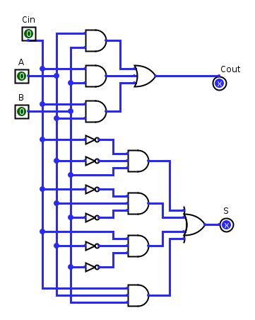
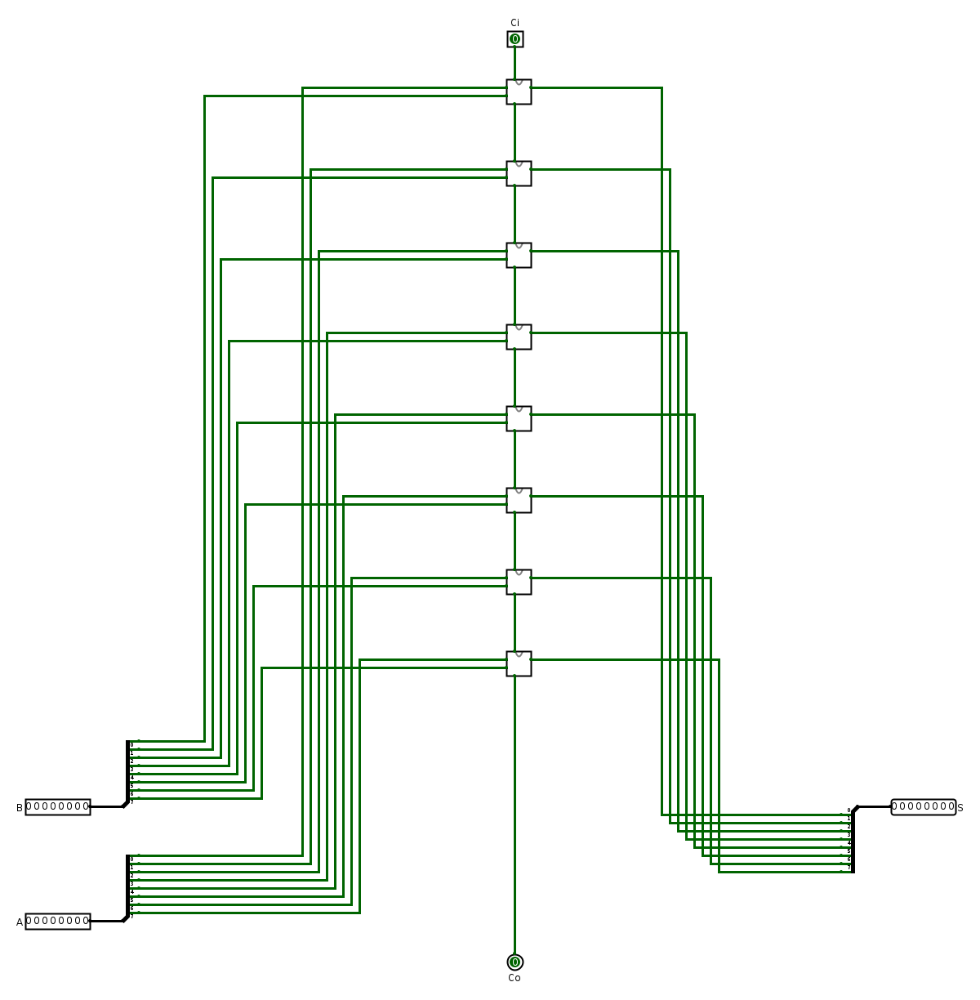

# Lab 8: Introduction to Logisim (full adder FA0 and 8-bit ripple-carry adder)

**Deliverable:** [`lab08_rca8.circ`](lab08_rca8.circ). It is a Logisim 2.7.1 file and opens with `RCA8` as the main circuit.

| Circuit | How it was made (following the lab steps) |
|---|---|
| `FA0` | *Circuit Analysis* route. Inputs `Cin, A, B`, outputs `Cout, S`, full-adder truth table filled in, then **Build Circuit** named `FA0`. This is Logisim's own `CircuitBuilder`, the code behind that button, so the gates are the minimised sum-of-products Logisim derives (Figure 8.3). Afterwards **Ci was turned to face south and Co to face north**, as the lab asks, so FA0 can be used as a block. |
| `RCA8` | Two **east-facing** splitters (8 bits in, fan-out 8) on inputs `A` and `B`, one **west-facing** splitter on output `S`, and **eight FA0 instances**. The S outputs go to the S splitter, A/B inputs come from their splitters, and the carry is chained from `Ci` through the eight adders to `Co`. |

Note on Figure 8.5: Logisim draws a pin on the edge *opposite* the direction it faces. So with the orientation the text asks for (Ci south, Co north), Ci appears on the **top** of the FA0 block and Co on the **bottom**. Figure 8.5 shows the mirror image. The behaviour is the same either way: in `RCA8` the carry simply flows from top to bottom.

## Tests (Logisim simulator, [`test-results.txt`](test-results.txt))

- **FA0:** all 8 truth-table rows pass.
- **RCA8:** all **131 072** combinations of `A` (8 bits), `B` (8 bits) and `Ci` pass. `S` and `Co` match A + B + Ci, with no unknown or error bits and no width mismatches.
- **GUI:** the file opens in the real Logisim GUI without any error dialog: [`gui-open-check.txt`](gui-open-check.txt), [`gui_screenshot.png`](gui_screenshot.png).

## Pictures (exported by Logisim)

| FA0 | RCA8 |
|---|---|
|  |  |
