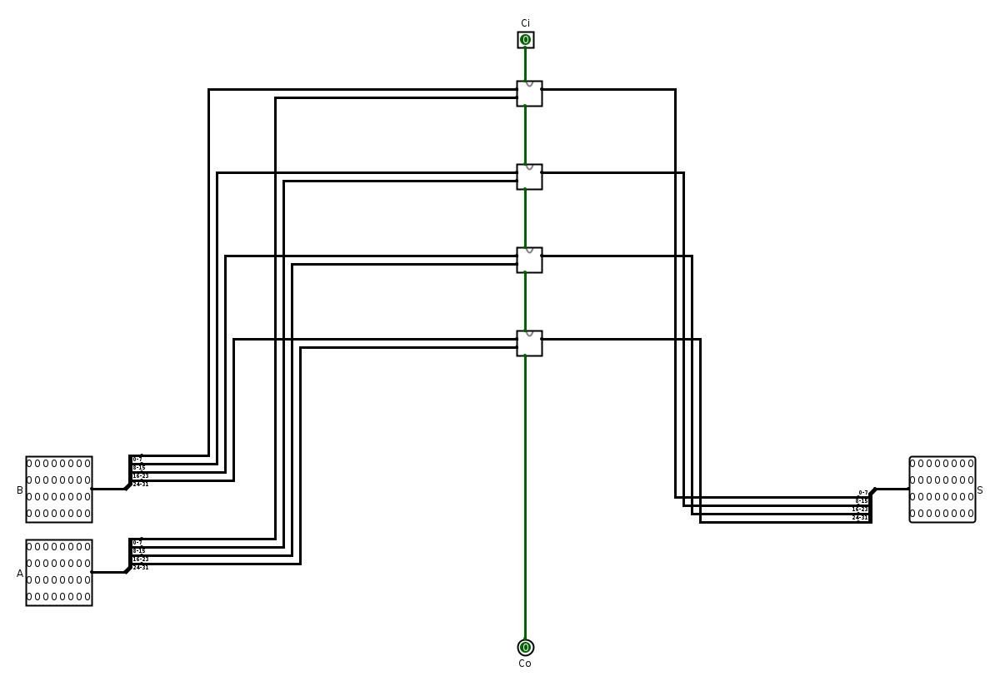

# Lab 9: 32-bit adder built from 8-bit RCA blocks

**Deliverable:** [`lab09_adder32.circ`](lab09_adder32.circ), with `Adder32` as the main circuit. The file is self-contained: it also
holds `FA0` and `RCA8` from Lab 8, so no library has to be loaded.

`Adder32` follows the lab steps:
- two **east-facing** splitters (32 bits in, fan-out 4, so each output is 8 bits) on `A` and `B`
- one **west-facing** splitter that joins four 8-bit buses into the 32-bit `S`
- **four RCA8 instances**, with the carry chained `Ci → RCA8₀ → RCA8₁ → RCA8₂ → RCA8₃ → Co`

## Tests (Logisim simulator, [`test-results.txt`](test-results.txt))

- **Edge cases:** 392 vectors. Every pair of {0, 1, 2, 0x7FFFFFFF, 0x80000000, 0xFFFFFFFF, byte-boundary values, …}, each with Ci = 0 and 1.
- **Random:** 20 000 vectors (seed 302). `S` and `Co` equal A + B + Ci in every case.
- **RCA8 inside this file:** 2 000 random vectors.
- **Result:** 22 393 checks, 0 failures.
- **GUI:** opens in the real Logisim GUI without errors: [`gui-open-check.txt`](gui-open-check.txt), [`gui_screenshot.png`](gui_screenshot.png).

## Picture (exported by Logisim)

