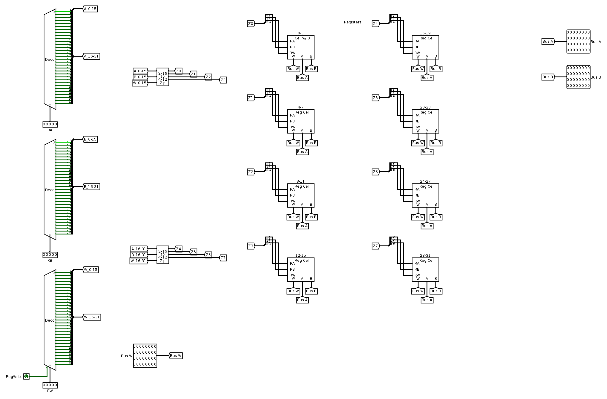
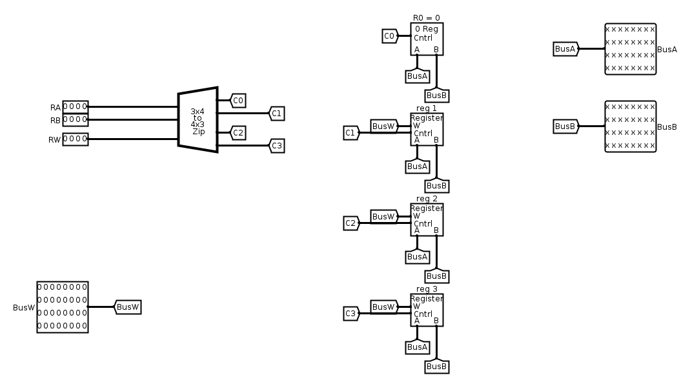
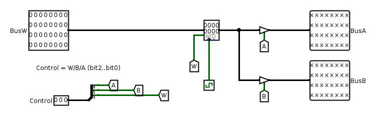
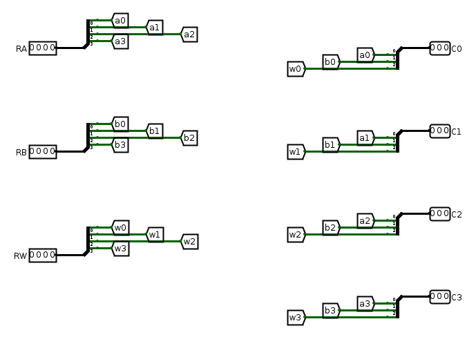
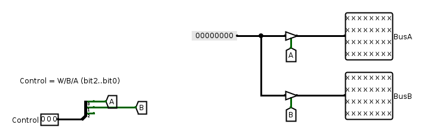

# Lab 10: 32 × 32-bit register file

**Deliverable:** [`lab10_register_file.circ`](lab10_register_file.circ), with `Register File` as the main circuit.

The design follows the **register file shown in class** (the instructor's "12 CPU" Logisim project in the lab photos). It uses the same
sub-circuit hierarchy, names, pins and block symbols. The idea is the same as **Figure 10.2**: decoders select the register, tri-state buffers
drive Bus A / Bus B, `RegWrite` gates the write, and register 0 is the constant 0.
The file was built from scratch with Logisim's own API (see the [root README](../README.md)). It was **not** copied from the class file.

| Interface of `Register File` | Width | Meaning |
|---|---|---|
| `RA`, `RB` | 5 | Registers read on `Bus A` / `Bus B` |
| `RW` | 5 | Register to write |
| `Bus W` | 32 | Data to write |
| `RegWrite` | 1 | Write enable |
| `Bus A`, `Bus B` | 32 | Read ports (combinational) |

There is no clock pin. As in the class design, each register has a **Clock component inside**, so in Logisim you write with
**Simulate > Tick Once (Ctrl+T)**. Registers load on the rising edge.

## Hierarchy (same names as in class)

| Circuit | What it does |
|---|---|
| `32 bit Register` | A 32-bit register plus two 32-bit tri-state buffers. `Control` (3 bits) = {W, B, A}: bit 2 enables the write, bits 1/0 drive the register onto Bus B / Bus A |
| `32 bit 0 Register` | The same, but the value is the constant 0 and there is no write input (this is R0) |
| `3x4 zipper` | Takes the 4-bit one-hot slices of the RA/RB/RW decoders and makes 4 `Control` words, Ci = {RW[i], RB[i], RA[i]} |
| `3x4 Zipper (4 wide)` | The same on 16-bit slices: 4 × 12-bit outputs, one per register cell |
| `Register Cell` | 4 × `32 bit Register` + `3x4 zipper`, sharing Bus W / Bus A / Bus B |
| `Register Cell w/ 0` | The same, but its first register is the `32 bit 0 Register` |
| `Register File` | Three 5→32 decoders. The `RW` decoder is enabled by `RegWrite`; when it is off, every output is 0. Then 2 × `3x4 Zipper (4 wide)` and 8 cells (`0-3` is the cell w/ 0, then `4-7` … `28-31`) |

All sub-circuits have custom symbols drawn like the class ones, for example the "3x4 to 4x3 Zip" trapezoid and the "Register / W / Cntrl / A / B" box.
They were drawn through Logisim's appearance model (`CircuitAppearance`), the same model the Appearance editor uses.

## Tests (Logisim simulator, [`test-results.txt`](test-results.txt)): 25 451 checks, 0 failures

- `3x4 zipper`: all 4 096 inputs. `3x4 Zipper (4 wide)`: 2 000 random inputs.
- `32 bit Register`: it writes only when W = 1 on the clock edge, and Bus A / Bus B float (`x`) unless A / B is enabled. `32 bit 0 Register` always reads 0.
- `Register File`:
  1. At power-up, every register reads 0.
  2. A random value is written to every register R0 … R31, then all **1 024 (RA, RB) pairs** are read back. R0 stays 0.
  3. With `RegWrite = 0`, clock ticks change nothing.
  4. The write happens on the rising edge only.
  5. Read-during-write with `RA = RB = RW`: the old value shows before the edge and the new value after it.

**GUI:** opens in the real Logisim GUI without errors: [`gui-open-check.txt`](gui-open-check.txt), [`gui_screenshot.png`](gui_screenshot.png).

**Try it:** with the Poke tool, set `RW`, `Bus W` and `RegWrite = 1`, then press Ctrl+T twice (one clock cycle). Change `RA` / `RB` to read.

## Pictures (exported by Logisim)

| `Register Cell w/ 0` | `32 bit Register` |
|---|---|
|  |  |
| `3x4 zipper` | `32 bit 0 Register` |
|  |  |
