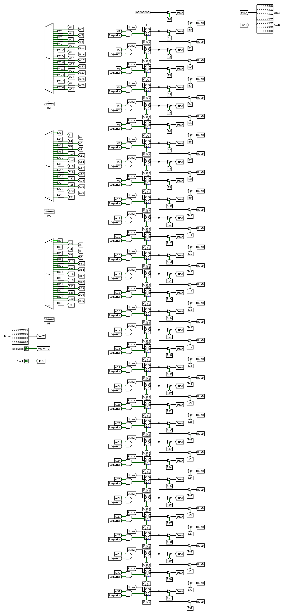

# Lab 10: 32 × 32-bit register file

**Deliverable:** [`lab10_register_file.circ`](lab10_register_file.circ). The single module `RegisterFile` is built exactly as in
**Figure 10.2**.

| Interface | Width | Meaning |
|---|---|---|
| `RA`, `RB` | 5 | Registers to read on `BusA` / `BusB` |
| `RW` | 5 | Register to write |
| `BusW` | 32 | Data to write |
| `RegWrite` | 1 | Write enable |
| `Clock` | 1 | Writes happen on the **rising edge** |
| `BusA`, `BusB` | 32 | Read ports (combinational) |

## Inside the module

- **Three 5→32 decoders.** The `RW` decoder selects the register to write. The `RA` and `RB` decoders drive the tri-state buffer enables.
- **R1–R31:** 32-bit registers, rising-edge triggered. Each one's enable is `AND(decoderW[i], RegWrite)`.
  The decoder's output 0 is unused ("R0 is not used"), so nothing can be written to R0.
- **R0** is the constant `0`, fed into its two tri-state buffers.
- **64 tri-state buffers** (32 per bus). Buffer *i* on BusA is enabled by `decoderA[i]`, and the one on BusB by `decoderB[i]`.
- **Tunnels** (Wiring > Tunnel, introduced in Lab 8) carry the `BusW`, `RegWrite`, `Clock`, decoder-output and bus nets. This avoids hundreds of crossing wires.

## Tests (Logisim simulator, [`test-results.txt`](test-results.txt)): 1 062 checks, 0 failures

1. At power-up every register reads 0 on both buses.
2. A random value is written to every register R0…R31, then all **1 024 (RA, RB) pairs** are read back. R0 still reads 0.
3. With `RegWrite = 0`, clock edges do not change any register.
4. A write happens only on the rising edge. Changing BusW while the clock is high, and the falling edge, both have no effect.
5. Read-during-write on the same register (`RA = RB = RW`): the old value is visible before the edge, the new value after it.

**GUI:** the file opens in the real Logisim GUI without errors: [`gui-open-check.txt`](gui-open-check.txt), [`gui_screenshot.png`](gui_screenshot.png).

**Try it in Logisim:** select the hand (Poke) tool. Set `RW`, `BusW` and `RegWrite = 1`, then click `Clock` 0 → 1 to write. Change `RA`/`RB` to read.

## Picture (exported by Logisim)

