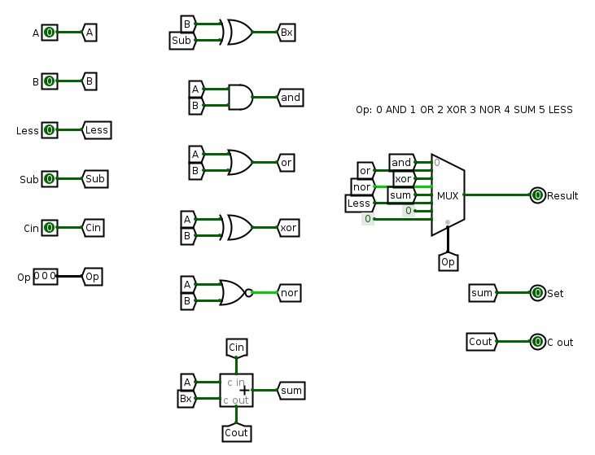

# Lab 11: 32-bit ALU

**Deliverable:** [`lab11_alu32.circ`](lab11_alu32.circ), with `32 Bit ALU` as the main circuit.

The design follows the **ALU shown in class** (the instructor's "12 CPU" Logisim project in the lab photos): one `1 bit ALU` slice
repeated 32 times. It has the same names, pins, op codes and block symbols. It was built from scratch with Logisim's own API
(see the [root README](../README.md)). It was **not** copied from the class file.

## `1 bit ALU`

Inputs: `A`, `B`, `Less`, `Sub`, `Cin`, `Op` (3 bits). Outputs: `Result`, `C out`, `Set`.

| `Op` | Result |
|---|---|
| 0 | A AND B |
| 1 | A OR B |
| 2 | A XOR B |
| 3 | A NOR B |
| 4 | SUM = A + (B ⊕ Sub) + Cin. `C out` = carry and `Set` = sum bit (for every Op) |
| 5 | `Less` |
| 6, 7 | unused (0) |

Inside the slice:
- an XOR makes B ⊕ Sub;
- AND, OR, XOR and NOR gates compute the logic ops;
- a 1-bit Adder computes SUM;
- an 8→1 multiplexer picks the result using `Op`.

## `32 Bit ALU`

Inputs: `A`, `B` (32 bits), `Sub`, `Op` (3 bits). Outputs: `Result` (32 bits) and `Zero flag`.

- 32 slices, with the carry rippling from `C out` of bit *i* into `Cin` of bit *i+1*. `Cin` of bit 0 = `Sub`, so `Sub = 1` with `Op = 4` gives A − B (two's complement).
- **SLT** (`Sub = 1`, `Op = 5`): bit 0's `Less` = bit 31's `Set` (the sign of A − B). The other bits' `Less` = 0.
- `Zero flag` is a 32-input NOR of the result.

| Instruction | `Sub` | `Op` |
|---|---|---|
| and / or / xor / nor | 0 | 0 / 1 / 2 / 3 |
| add | 0 | 4 |
| sub (beq compare) | 1 | 4 |
| slt | 1 | 5 |

Note: as in the class design, SLT returns the sign bit of A − B. That equals signed A < B whenever A − B does not overflow; the tests check this.
If A − B overflows (for example A = 0x80000000, B = 1), the sign bit is wrong. Fixing that would need sign ⊕ overflow.

## Tests (Logisim simulator, [`test-results.txt`](test-results.txt)): 21 225 checks, 0 failures

- `1 bit ALU`: every `Op` (0–7) × all 32 combinations of A, B, Less, Sub and Cin. `Result`, `Set` and `C out` are checked on all of them.
- `32 Bit ALU`: AND, OR, XOR, NOR, ADD, SUB, SLT and the unused Op 6/7 on 2 145 (A, B) pairs: 144 edge-case pairs, 2 000 random pairs and A = B.
  `Result` and `Zero flag` are checked every time. SLT is also compared with true signed A < B on every pair where A − B does not overflow.

**GUI:** opens in the real Logisim GUI without errors: [`gui-open-check.txt`](gui-open-check.txt), [`gui_screenshot.png`](gui_screenshot.png).

## Pictures (exported by Logisim)

