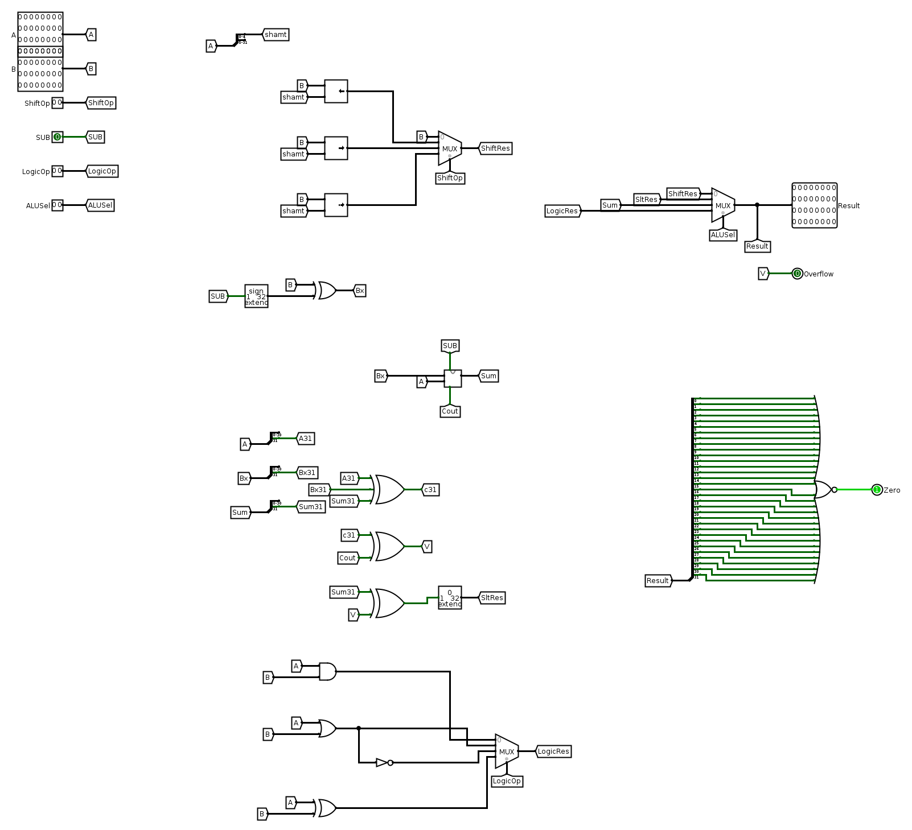

# Lab 11: 32-bit ALU

**Deliverable:** [`lab11_alu32.circ`](lab11_alu32.circ), with `ALU32` as the main circuit. It follows **Figure 11.3**, and the
arithmetic block **reuses the Lab 9 adder** (`Adder32` → 4 × `RCA8` → 32 × `FA0`). All of those circuits are inside the same file.

## Control encoding (from Figure 11.3)

| `ALUSel` | Block | Sub-control |
|---|---|---|
| `00` | Shifter | `ShiftOp`: 00 none (passes B), 01 SLL, 10 SRL, 11 SRA. The shifted data is **B**; the shift amount is **A[4:0]** ("lsb 5") |
| `01` | Comparator (SLT) | Set `SUB = 1`. Result = sign ⊕ overflow, zero-extended to 32 bits |
| `10` | Arithmetic | `SUB`: 0 ADD, 1 SUB (B is XORed with SUB, and carry-in = SUB) |
| `11` | Logic | `LogicOp`: 00 AND, 01 OR, 10 NOR (OR followed by NOT, as in the figure), 11 XOR |

Outputs: `Result` (32 bits), `Zero` (a 32-input NOR of the result bits) and `Overflow`.

How overflow is computed:
- Overflow is the XOR of the carry into bit 31 (c31) and the carry out of bit 31 (c32 = `Cout` of the adder).
- The 8-bit RCA block from Lab 9 does not expose c31, so it is recovered from the adder's own signals: c31 = A31 ⊕ B′31 ⊕ S31, because S31 = A31 ⊕ B′31 ⊕ c31.
- This is exactly the "XOR of the last two carries" from the lab text.

## Tests (Logisim simulator, [`test-results.txt`](test-results.txt)): 34 585 checks, 0 failures

The test covers **all 11 operations**: pass-B, SLL, SRL, SRA, SLT, ADD, SUB, AND, OR, NOR, XOR.
- Each operation runs on 3 144 (A, B) pairs: 144 edge-case pairs (0, 1, 31, 32, 0x7FFFFFFF, 0x80000000, 0xFFFFFFFF, …) and 3 000 random pairs.
- `Result` and `Zero` are checked every time, and `Overflow` too for ADD and SUB.
- The log includes worked examples, e.g. 0x7FFFFFFF + 1 → 0x80000000 with Overflow = 1, and SLT(−1, 1) = 1.

**GUI:** opens in the real Logisim GUI without errors: [`gui-open-check.txt`](gui-open-check.txt), [`gui_screenshot.png`](gui_screenshot.png).

## Picture (exported by Logisim)

