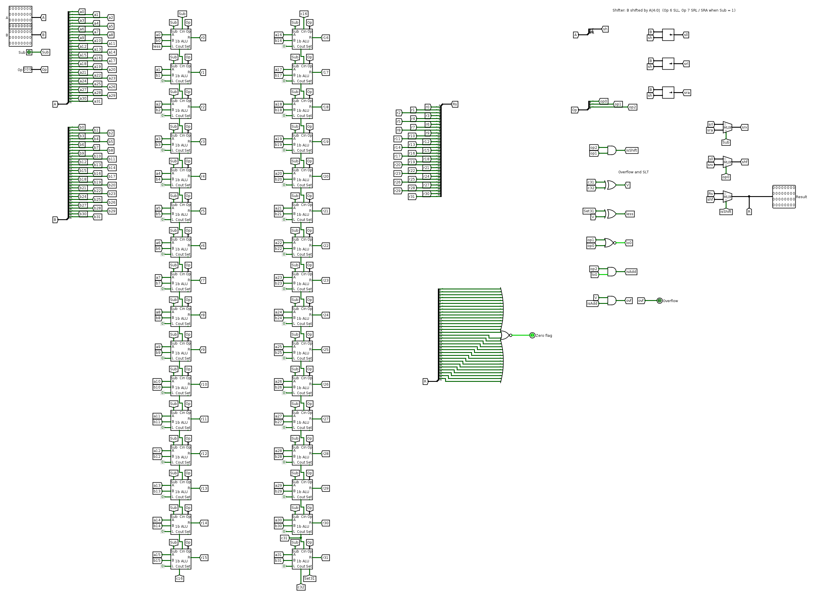
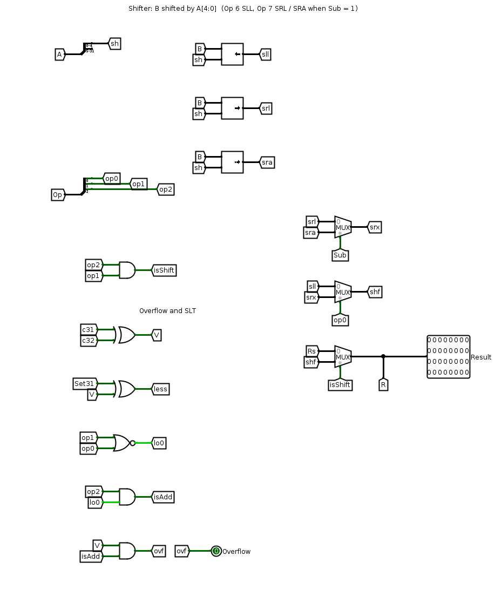

# Lab 11: 32-bit ALU

**Deliverable:** [`lab11_alu32.circ`](lab11_alu32.circ), with `32 Bit ALU` as the main circuit.

The design follows the **ALU shown in class** (the instructor's "12 CPU" Logisim project in the lab photos): one `1 bit ALU` slice
repeated 32 times. It has the same names, pins, op codes and block symbols. It was built from scratch with Logisim's own API
(see the [root README](../README.md)). It was **not** copied from the class file.

On top of the class design, `32 Bit ALU` also has the parts the lab sheet (Appendix 11) asks for: a **shifter block**
(SLL, SRL, SRA), an **Overflow** output, and an **SLT that is correct even when A − B overflows**.

## `1 bit ALU`

Inputs: `A`, `B`, `Less`, `Sub`, `Cin`, `Op` (3 bits). Outputs: `Result`, `C out`, `Set`.

| `Op` | Result |
|---|---|
| 0 | A AND B |
| 1 | A OR B |
| 2 | A XOR B |
| 3 | A NOR B |
| 4 | SUM = A + (B ⊕ Sub) + Cin. `C out` = carry and `Set` = sum bit (for every Op) |
| 5 | `Less` |
| 6, 7 | 0 (in `32 Bit ALU` these codes select the shifter instead) |

Inside the slice:
- an XOR makes B ⊕ Sub;
- AND, OR, XOR and NOR gates compute the logic ops;
- a 1-bit Adder computes SUM;
- an 8→1 multiplexer picks the result using `Op`.

## `32 Bit ALU`

Inputs: `A`, `B` (32 bits), `Sub`, `Op` (3 bits). Outputs: `Result` (32 bits), `Overflow` and `Zero flag`.

- 32 slices, with the carry rippling from `C out` of bit *i* into `Cin` of bit *i+1*. `Cin` of bit 0 = `Sub`, so `Sub = 1` with `Op = 4` gives A − B (two's complement).
- **Overflow:** V = (carry into bit 31) ⊕ (carry out of bit 31). The `Overflow` pin shows V for add/sub (`Op = 4`) and is 0 for every other op.
- **SLT** (`Sub = 1`, `Op = 5`): bit 0's `Less` = `Set` of bit 31 ⊕ V. That is the true signed A < B, even when A − B overflows
  (for example A = 0x80000000, B = 1 gives 1). The other bits' `Less` = 0.
- **Shifter block:** three Logisim Shifters shift **B by A[4:0]**: logical left, logical right, arithmetic right. `Op = 6` is SLL.
  `Op = 7` is SRL when `Sub = 0` and SRA when `Sub = 1`. A 2:1 mux passes the shifter output when `Op` = 6 or 7, and the slices' result otherwise.
- `Zero flag` is a 32-input NOR of the final result.

| Instruction | `Sub` | `Op` | |
|---|---|---|---|
| and / or / xor / nor | 0 | 0 / 1 / 2 / 3 | |
| add | 0 | 4 | `Overflow` valid |
| sub (beq compare) | 1 | 4 | `Overflow` valid |
| slt | 1 | 5 | |
| sll | 0 | 6 | B << A[4:0] |
| srl | 0 | 7 | B >> A[4:0], zeros shifted in |
| sra | 1 | 7 | B >> A[4:0], sign bit shifted in |

For `sll rd, rt, shamt` the datapath puts `rt` on B and `shamt` on A[4:0]. For `sllv` / `srlv` / `srav`, `rs` goes on A.

## Tests (Logisim simulator, [`test-results.txt`](test-results.txt)): 23 852 checks, 0 failures

- `1 bit ALU`: every `Op` (0–7) × all 32 combinations of A, B, Less, Sub and Cin. `Result`, `Set` and `C out` are checked on all of them.
- `32 Bit ALU`: AND, OR, XOR, NOR, ADD, SUB, SLT, SLL, SRL and SRA (plus SLL with `Sub = 1`) on 2 145 (A, B) pairs: 144 edge-case pairs, 2 000 random pairs and A = B.
  `Result`, `Zero flag` and `Overflow` are checked every time:
  - `Overflow` is 1 exactly on the 533 ADD and 482 SUB pairs that overflow, and 0 on every other op.
  - SLT equals true signed A < B on **every** pair, including the 482 pairs where A − B overflows.

**GUI:** opens in the real Logisim GUI without errors: [`gui-open-check.txt`](gui-open-check.txt), [`gui_screenshot.png`](gui_screenshot.png).

## Pictures (exported by Logisim)

