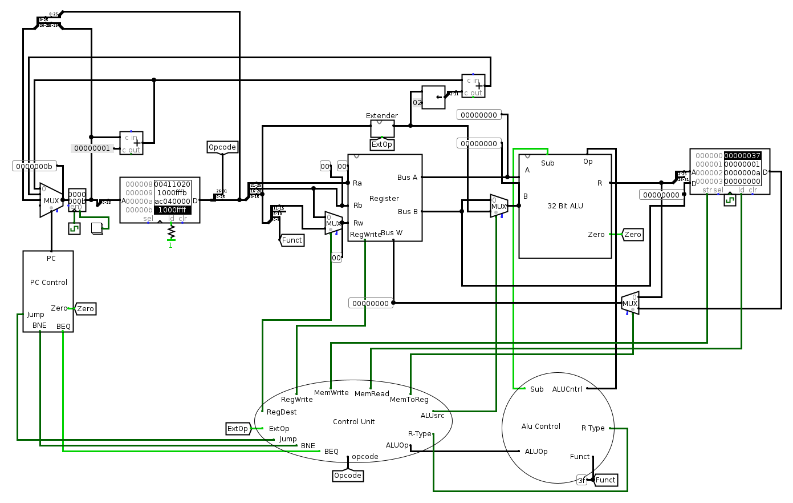

# Lab 12: Single-cycle CPU (analysing `prog1.txt` / `mem1.txt`)

> **Not generated by me (external files).** Everything in [`external-mini-mips/`](external-mini-mips) is copied unchanged from
> **[github.com/Kumbong/mini-mips](https://github.com/Kumbong/mini-mips)** (commit `8118227`, MIT licence, © Kumbong Hermann; see
> [`external-mini-mips/LICENSE`](external-mini-mips/LICENSE)). That includes:
> - the CPU itself, `cpu/Single_Cycle_Cpu.circ`, which is a Logisim 2.7.1 file
> - the test images `test files/prog1.txt` and `test files/mem1.txt`
>
> The Lab 12 sheet's instructions match that project's README word for word, so it is the CPU the lab refers to.
> The files I made are everything else in this folder: the disassembly, the trace, and the MARS checks.

## How the files were run, and how to run them yourself

Steps from the lab sheet, done in the real **Logisim 2.7.1**:

1. Open `external-mini-mips/cpu/Single_Cycle_Cpu.circ` and reset the simulation (Simulate > Reset Simulation).
2. Right-click the **instruction memory** (the left RAM) > *Load Image…* > `external-mini-mips/test files/prog1.txt`.
3. Right-click the **data memory** (the right RAM) > *Load Image…* > `external-mini-mips/test files/mem1.txt`.
4. Press **Ctrl+T** repeatedly. Each press is one clock tick, and two ticks make one CPU cycle.

[`../build/src/Cpu12.java`](../build/src/Cpu12.java) does exactly these steps through Logisim's own code (`Ram.loadImage`,
`Propagator.tick`) and records PC and instruction on every cycle: [`trace_prog1.txt`](trace_prog1.txt).
After 60 cycles, data memory holds `[0] = 0x00000037 = 55`.

## Task: the MIPS instructions in `prog1.txt`

`mem1.txt` puts three words in data memory: `word[0] = 1`, `word[1] = 1`, `word[2] = 10`.

| Byte addr | Machine code | Type | op | rs | rt | rd | other fields | MIPS instruction |
|---|---|---|---|---|---|---|---|---|
| 0x00 | `00000022` | R | 000000 | 0 | 0 | 0 | shamt=0, funct=0x22 | `sub $0, $0, $0` (no-op) |
| 0x04 | `8C010000` | I | 100011 | 0 | 1 | – | imm=0 | `lw  $1, 0($0)` |
| 0x08 | `8C020004` | I | 100011 | 0 | 2 | – | imm=4 | `lw  $2, 4($0)` |
| 0x0C | `8C030008` | I | 100011 | 0 | 3 | – | imm=8 | `lw  $3, 8($0)` |
| 0x10 | `00842022` | R | 000000 | 4 | 4 | 4 | shamt=0, funct=0x22 | `sub $4, $4, $4` |
| 0x14 | `00822020` | R | 000000 | 4 | 2 | 4 | shamt=0, funct=0x20 | `loop: add $4, $4, $2` |
| 0x18 | `0043282A` | R | 000000 | 2 | 3 | 5 | shamt=0, funct=0x2a | `slt $5, $2, $3` |
| 0x1C | `10A00002` | I | 000100 | 5 | 0 | – | imm=+2 | `beq $5, $0, done` |
| 0x20 | `00411020` | R | 000000 | 2 | 1 | 2 | shamt=0, funct=0x20 | `add $2, $2, $1` |
| 0x24 | `1000FFFB` | I | 000100 | 0 | 0 | – | imm=−5 | `beq $0, $0, loop` |
| 0x28 | `AC040000` | I | 101011 | 0 | 4 | – | imm=0 | `done: sw $4, 0($0)` |
| 0x2C | `1000FFFF` | I | 000100 | 0 | 0 | – | imm=−1 | `halt: beq $0, $0, halt` |

The full source with comments is in [`prog1.asm`](prog1.asm). To make sure the disassembly is right, I assembled it in **MARS 4.5** (memory
configuration *Compact, Data at Address 0*). The machine code MARS produces is identical to `prog1.txt`:
[`prog1_mars_machine_code.txt`](prog1_mars_machine_code.txt), [`prog1_mars_check.txt`](prog1_mars_check.txt).

**Equivalent C:** `i = 1; sum = 0; do { sum += i; } while (i++ < 10); mem[0] = sum;`, which gives **sum = 1 + 2 + … + 10 = 55**.

**Branch targets.** The immediate counts words relative to PC + 4:
- `beq` at 0x1C: target = 0x1C + 4 + 4×2 = **0x28** (`done`)
- `beq` at 0x24: target = 0x24 + 4 + 4×(−5) = **0x14** (`loop`)
- `beq` at 0x2C: target = 0x2C + 4 + 4×(−1) = **0x2C**, i.e. the CPU spins on itself to halt

## How the single-cycle CPU executes each instruction (Figure 12.8)

| Instr. | RegDst | RegWrite | ExtOp | ALUSrc | ALU op | Beq | J | MemRead | MemWrite | MemtoReg | What happens in the datapath |
|---|---|---|---|---|---|---|---|---|---|---|---|
| `add`/`sub`/`slt` (R) | 1 (Rd) | 1 | x | 0 (BusB) | from funct | 0 | 0 | 0 | 0 | 0 (ALU) | Reg(Rd) ← Reg(Rs) op Reg(Rt), PC ← PC+4 |
| `lw` | 0 (Rt) | 1 | 1 (sign) | 1 (imm) | ADD | 0 | 0 | 1 | 0 | 1 (Mem) | Reg(Rt) ← MEM[Reg(Rs) + ext(imm)], PC ← PC+4 |
| `sw` | x | 0 | 1 (sign) | 1 (imm) | ADD | 0 | 0 | 0 | 1 | x | MEM[Reg(Rs) + ext(imm)] ← Reg(Rt), PC ← PC+4 |
| `beq` | x | 0 | x | 0 (BusB) | SUB | 1 | 0 | 0 | 0 | x | Zero ← (Rs − Rt == 0); PCSrc = Beq·Zero, so PC ← PC+4+4·imm if taken |

Here x means "don't care". PCSrc = J + Beq·Zero + Bne·Zero′ (NextPC block, Figure 12.7).

## Cycle-by-cycle trace (from [`trace_prog1.txt`](trace_prog1.txt))

| Cycles | PC (bytes) | What happens |
|---|---|---|
| 0–4 | 0x00 → 0x10 | Set-up: `$1 = 1`, `$2 = 1`, `$3 = 10`, `$4 = 0` |
| 5–49 | 0x14 → 0x24, 9 times | Loop body for i = 1…9. Each pass: `sum += i`, `slt` gives 1, `beq` not taken, `i++`, branch back |
| 50–52 | 0x14, 0x18, 0x1C | Last pass, i = 10: `sum = 55`, `slt $5 = 0`, so `beq` is **taken** and jumps to 0x28 |
| 53 | 0x28 | `sw $4, 0($0)` writes 55 to data memory word 0 |
| 54+ | 0x2C | `beq $0,$0,-1` keeps the PC at 0x2C (program finished) |

The program needs 54 cycles in total: 5 + 9×5 + 3 + 1. CPI = 1, since every instruction takes exactly one cycle in a single-cycle CPU.

Final state, which matches MARS: `$1 = 1`, `$2 = 10`, `$3 = 10`, `$4 = 55`, `$5 = 0`, and **data memory word 0 = 55**.
